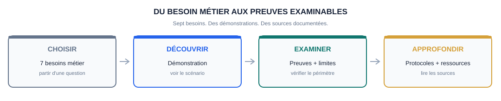

 · 

# Des problèmes métier. Des résultats documentés. Des preuves consultables.

**Savoir ce que fait votre IA. Prouver ce qui s'est passé. Moins de suppositions. Plus de preuves.**

**INSTALL → TRACE → MEASURE → VERIFY → ACT**

**[Explorer les démos](https://neomundi.io/fr/demonstration/)** · **[Voir les 7 besoins](#explorer-7-besoins-ia--accéder-aux-démonstrations)** · **[Étudier un déploiement](https://neomundi.io/fr/contact/)**

[Architecture produit](https://github.com/neomundi-io/.github/blob/main/docs/PRODUCT_ARCHITECTURE.fr.md) · [Tous les composants](https://github.com/orgs/neomundi-io/repositories)

**[neomundi.io](https://neomundi.io/)**

---

## Du besoin métier aux preuves examinables

  <picture>
    <source media="(prefers-color-scheme: dark)" srcset="https://raw.githubusercontent.com/neomundi-io/neomundi-use-cases/main/assets/use-cases-journey-fr-dark.svg">
    
  </picture>

**Les démos illustrent des scénarios produit. Les preuves des pilotes sont documentées séparément.** Chaque cas ci-dessous renvoie aux démonstrations pertinentes et, lorsqu'elles existent, aux sources qui étayent ses résultats.

---

## Explorer 7 besoins IA — accéder aux démonstrations

**Une primitive de mesure. De multiples applications. De multiples infrastructures.**

Partez du problème que votre équipe veut résoudre. Chaque lien mène à une démonstration NeoMundi publiée ; les fiches détaillées distinguent les **démos illustratives** des **preuves documentées des pilotes**.

| Votre besoin | La question métier | Découvrir |
| --- | --- | --- |
| **01 · Audit des agents IA** | L'agent a-t-il réellement fait ce qu'il affirme ? | [Démo 5 — actions d'un agent](https://neomundi.io/fr/demonstration-5/) |
| **02 · Contrôle d'exécution** | Comment les observations éclairent-elles un contrôle en aval ? | [Démo 4 — agent en action](https://neomundi.io/fr/demonstration-4/) |
| **03 · Preuve et audit** | Un tiers peut-il examiner ce qui s'est passé ? | [Démo — parcours de preuve](https://neomundi.io/fr/demonstration/) |
| **04 · Qualité RAG** | Que change l'évaluation d'un assistant ? | [Démo 6 — assistant RAG](https://neomundi.io/fr/demonstration-6/) |
| **05 · IA en santé** | Que peut-on examiner dans un contexte sensible ? | [Démo 3 — santé](https://neomundi.io/fr/demo-3/) |
| **06 · Comparaison de modèles** | Comment comparer les réponses des modèles ? | [Démo 2 — comparaison](https://neomundi.io/fr/demonstration-2/) |
| **07 · Réponses contradictoires** | Que se passe-t-il lorsque deux réponses s'opposent ? | [Démo 7 — réponses opposées](https://neomundi.io/fr/demonstration-7/) |

**Choisir un besoin → voir la démo → consulter les documents techniques.** Les démos illustrent des parcours produit ; elles ne constituent pas des résultats pilotes supplémentaires.

---

## Cas documentés — problèmes, preuves et démonstrations

Les cas ci-dessous distinguent **mesure**, **preuve** et **décision en aval**. Un pilote n'est pas une référence client commerciale ; les preuves conservent le périmètre précisé dans leurs sources.

## 01 — AUDIT DES AGENTS IA

### Comment auditer les actions d'un agent IA ?

> **Problème métier**  
> Un agent prend des engagements ou déclare des actions. Comment comparer ses propos aux opérations enregistrées ?

| Application documentée | Résultats et périmètre | Preuves |
| --- | --- | --- |
| **AI Business / Express Test Purchase** · **E2 — Contrôlé** | Trois achats tests contrôlés, dont des reçus conformes et volontairement défectueux. **Environnement synthétique** ; aucun résultat de souscription ou d'assurance n'est revendiqué. | [Preuves contrôlées](https://github.com/neomundi-io/use-case-aibusiness-runtime-conformity) |
| **Sergei Ponomarev / AI Business** · **E0 — En cours** | Mesure indépendante des réponses pour alimenter une comparaison distincte entre promesses, dialogue et journal d'exécution. Série du **6 novembre au 5 décembre 2026** ; résultats et identités des modèles **non publiés**. | [Protocole public](https://github.com/sergeiperm81-ux/ai-test-purchase) |

**Valeur métier →** Distinguer les observations de l'autorité chargée de juger l'exécution réelle de l'agent.

**[Voir la démo 5 — prouver les actions d'un agent](https://neomundi.io/fr/demonstration-5/)** · Démonstration produit ; les sources ci-dessus restent les preuves des pilotes.

---

## 02 — CONTRÔLE DE L'EXÉCUTION

### Comment contrôler l'exécution d'agents sans confondre mesure et permission ?

> **Problème métier**  
> Des mesures peuvent éclairer une politique, sans devenir elles-mêmes une autorisation d'exécution.

| Application documentée | Résultats et périmètre | Preuves |
| --- | --- | --- |
| **OASSE / FAM / Gatekeeper** · **E3 — Borné** | Campagnes contrôlées de **1 000 et 60 requêtes**, séparant mesure, politique déterministe et traitement opérationnel. Les historiques **ALLOW/FLAG** sont des classifications de mesure, **pas des permissions d'exécution**. | [Étude](https://github.com/neomundi-io/use-case-oasse-runtime-governance) |
| **ManChine / RGE-01, REB-01, RiCo-01** · **E1 — Documenté** | Architecture publique pour l'admissibilité pré-action, la frontière d'exécution et sa continuité ; **validation machine-à-machine complète en attente**. | [Architecture](https://github.com/neomundi-io/use-case-rico-observation-to-admissibility) |

**Valeur métier →** Conserver des responsabilités séparées entre mesure, politique et décision opérationnelle.

**[Voir la démo 4 — mesurer un agent en action](https://neomundi.io/fr/demonstration-4/)** · Illustration d'un parcours agentique, pas une validation universelle des actions en aval.

---

## 03 — PREUVE & AUDIT

### Comment reconstruire et vérifier une preuve après une interaction IA ?

> **Problème métier**  
> Une réponse contestée ou un audit exige des enregistrements examinables, pas seulement un compte rendu.

| Application documentée | Résultats et périmètre | Preuves |
| --- | --- | --- |
| **FactNotebook** · **E3 — Borné** | **Cinq cas PubMedQA** instrumentés, puis reconstruits par le partenaire. **Moteur de reconstruction non public** ; aucune vérité médicale établie. | [Pilote NeoMundi](https://github.com/neomundi-io/use-case-factnotebook-pubmedqa) · [Reconstruction partenaire](https://github.com/factnotebook/public-reconstructions/tree/main/FN-NEOMUNDI-CTPUBMEDQA-001) |
| **Mark Mocnaj / Project Petunia × Judicator (OGS)** · **E2 — Synthétique** | Cinq payloads synthétiques d'interopérabilité et reçus liés aux payloads ; le replay déterministe interne a reproduit les cinq classifications. **Aucune action externe autorisée ; aucune mesure réelle NeoMundi en production**. | [Étude d'interopérabilité](https://github.com/UmjetnaInteligencija/ogs-neomundi-public-interoperability-pilot) |

**Valeur métier →** Examiner ce que les preuves étayent réellement, avec intégrité et provenance explicites.

**[Voir la démonstration NeoMundi](https://neomundi.io/fr/demonstration/)** · Les pilotes cités restent les références des preuves.

---

## 04 — QUALITÉ DES ASSISTANTS RAG

### Comment vérifier qu'un assistant IA s'améliore ?

> **Problème métier**  
> Un assistant RAG a été corrigé. Comment comparer les résultats observables dans un protocole défini ?

| Application documentée | Résultats et périmètre | Preuves |
| --- | --- | --- |
| **Kabbalah App / RAG Test Bench** · **E3 — Borné** | **60 générations instrumentées par manche** ; alertes rapportées passant de **45/60 à 1/60** après correction. **Banc d'essai, données brutes et correspondances de notation privés**. | [Synthèse publique](evidence/kabbalah-app-rag/README_FR.md) |

**Valeur métier →** Documenter les changements observés plutôt que se fier aux impressions.

**[Voir la démo 6 — mesurer un assistant RAG](https://neomundi.io/fr/demonstration-6/)** · Démonstration distincte des résultats Kabbalah App.

---

## 05 — IA EN SANTÉ

### Comment examiner le comportement d'une IA dans un domaine sensible ?

**Besoin métier →** Examiner une réponse avec son contexte de mesure et de preuve, plutôt que se fier à une affirmation non étayée.

**Approche NeoMundi →** Instrumenter l'interaction, consulter les signaux comportementaux et conserver le dossier technique.

**[Voir la démo 3 — mesurer une IA de santé](https://neomundi.io/fr/demo-3/)** · Démonstration produit NeoMundi.

**Preuve documentée complémentaire →** [Pilote FactNotebook / PubMedQA](https://github.com/neomundi-io/use-case-factnotebook-pubmedqa). Il s'agit d'un pilote distinct, sans revendication de vérité médicale.

---

## 06 — COMPARAISON DE MODÈLES

### Comment documenter les différences entre réponses de modèles IA ?

**Besoin métier →** Comparer les réponses en conservant les conditions de mesure.

**Approche NeoMundi →** Enregistrer les observations, consulter les signaux disponibles et expliciter le contexte de comparaison.

**[Voir la démo 2 — comparaison de modèles IA](https://neomundi.io/fr/demonstration-2/)** · Démonstration produit, pas un benchmark comparatif publié.

---

## 07 — RÉPONSES CONTRADICTOIRES

### Que faire lorsque deux réponses IA se contredisent ?

**Besoin métier →** Examiner les réponses opposées sans confondre un score et une preuve de vérité factuelle.

**Approche NeoMundi →** Présenter les observations et les éléments de mesure disponibles pour permettre l'examen du désaccord.

**[Voir la démo 7 — deux réponses opposées, un seul verdict](https://neomundi.io/fr/demonstration-7/)** · Scénario produit illustratif, dont les conclusions restent liées au contexte de la démonstration.

---

## Pour aller plus loin — ressources et revues indépendantes

| Ressource | Accéder |
| --- | --- |
| **Catalogue complet des pilotes** | [12 entrées documentées, niveaux de preuve et références](CATALOG_FR.md) |
| **Measurement / Station / Evidence** | [API de mesure](https://github.com/neomundi-io/neomundi-runtime-measurement) · [Station](https://github.com/neomundi-io/neomundi-station-public) · [Evidence](https://github.com/neomundi-io/neomundi-evidence-gateway) |
| **Architecture** | [Architecture produit NeoMundi](https://github.com/neomundi-io/.github/blob/main/docs/PRODUCT_ARCHITECTURE.md) |
| **Revues indépendantes** | [Catalogue technique et revues](CATALOG_FR.md) |
| **Toutes les démonstrations** | [Découvrir NeoMundi](https://neomundi.io/fr/demonstration/) |

Les cas documentés sont des **démonstrations bornées et pilotes de recherche**, pas des certifications ni des preuves de conformité réglementaire. Les démos illustrent des parcours produit ; les protocoles décrivent la portée des preuves.

---

## Votre organisation, votre cas d'usage

**[Explorer les démos](https://neomundi.io/fr/demonstration/)** · **[Étudier un déploiement](https://neomundi.io/fr/contact/)**
